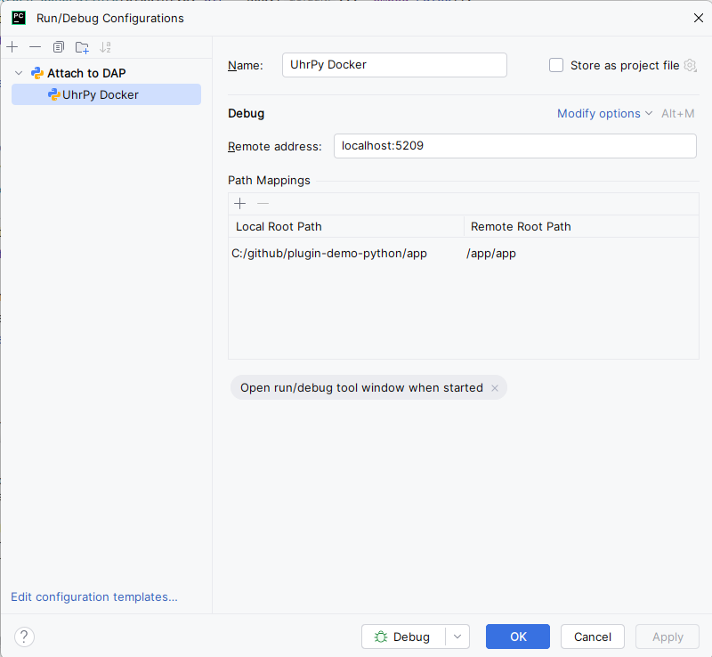

# plugindemo-python (Port von plugin-demo-java)

Dieses Projekt ist eine Python/FastAPI-Portierung der REST-API aus `plugin-demo-java`.
Der Fokus liegt auf denselben Endpoints + dem Demo-Plugin **Uhr1**.

## Build des Docker-Containers (build.bat)
```bash
docker build -t letto-plugin-demopython:latest -f Dockerfile .
```

## Installation am LeTTo-Server
* Installation des Docker-Containers:
  * kopiere yml/docker-service-plugindemopython.yml in /opt/letto/docker/compose/letto/ am LeTTo-Server 
  * starte den Container (docker compose -f /opt/letto/docker/compose/letto/ docker-service-plugindemopython.yml up -d)
* Proxy Konfiguration:
  * kopiere proxy/plugindemopython.conf in /opt/letto/docker/proxy/ am LeTTo-Server 
  * restarte den Proxy (docker restart letto-proxy)

## Debugging aus der PyCharm starten
* In der .env Datei die Zeile `DEBUG=true` aktivieren
* Run -> Edit Configurations -> Add New Configuration -> Attach to DAP
  * Name: UhrPy Docker debug
  * Remote address: localhost:5209
  * Local Root Path: c:/github/plugin-demo-python/app
  * Remote Root Path: /app/app
  * 
* Immer zuerst den Container neu starten (docker restart letto-plugindemopython), damit die Debug-Optionen wirksam werden.
* Dann Attach to DAP starten.

## Servicepfad
Alle externen Endpoints liegen unter dem `SERVICEPATH` (Standard: `/plugindemopython`).
Der Wert muss mit der `location` in `proxy/plugindemopython.conf` übereinstimmen.

## Wichtige Endpoints
- `GET /ping`  → `pong`
- `GET /plugindemopython/open/ping` → `pong`
- `GET /info` und `GET /plugindemopython/open/info` → `ServiceInfoDTO`
- `GET /plugindemopython/docs` → API-Doku (Swagger UI)
- `GET /plugindemopython/`, `/plugindemopython/index.html`, `/plugindemopython/help` → statische Hilfeseite (`resources/index.html`)

Interne Plugin-API (wie Java `@RequestMapping("/open")`):
- `GET  /open/pluginlist`
- `GET  /open/generalinfolist`
- `POST /open/generalinfo` (Body ist **String** wie in Java)
- `POST /open/gethtml`
- `POST /open/angabe`
- `POST /open/image`
- `POST /open/loadplugindto`
- `POST /open/score`
- ...

Für Proxy-Setups wird zusätzlich derselbe Satz unter `/plugindemopython/open/*` angeboten.

Externe Open-API (wie Java `@RequestMapping("/plugindemo/api/open")`):
- `GET  /plugindemopython/api/open/pluginlist`
- `GET  /plugindemopython/api/open/generalinfolist`
- `POST /plugindemopython/api/open/generalinfo`
- `POST /plugindemopython/api/open/reloadplugindto`
